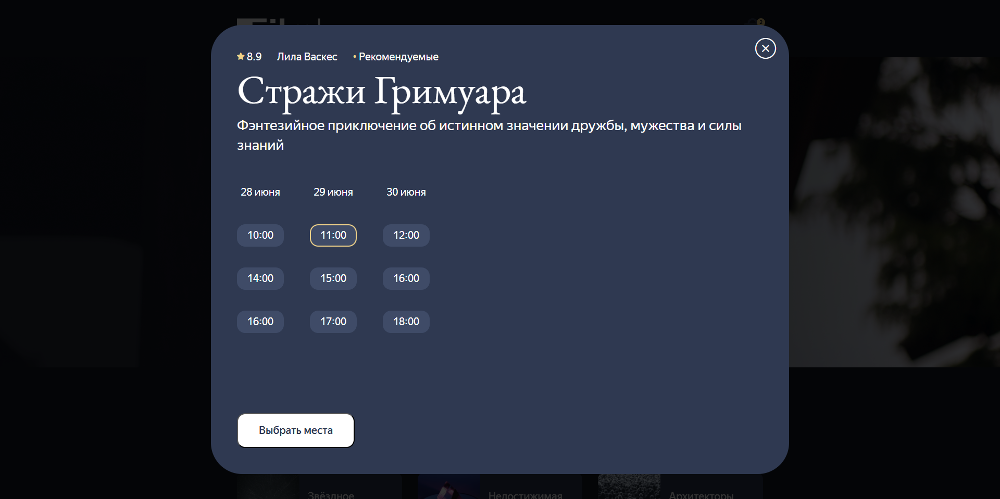
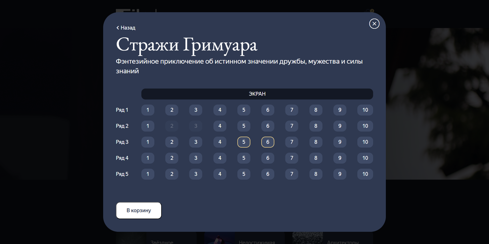
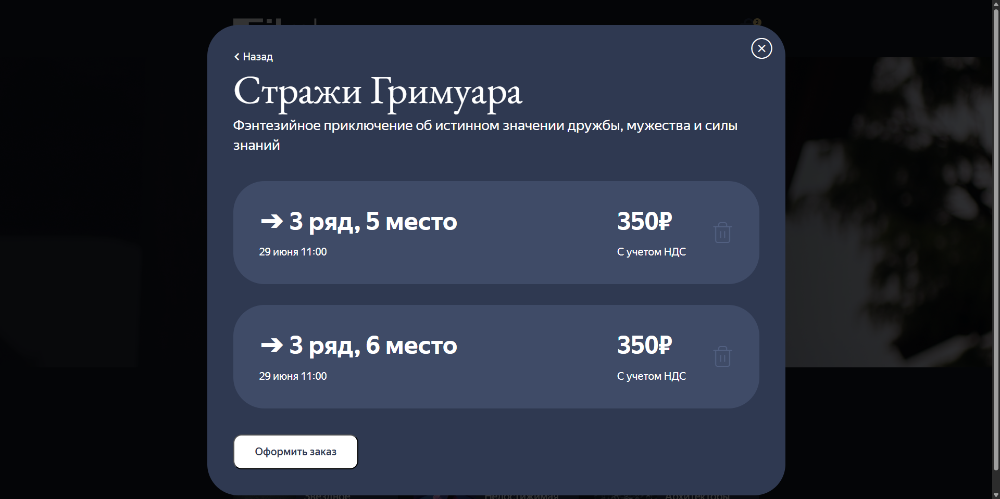
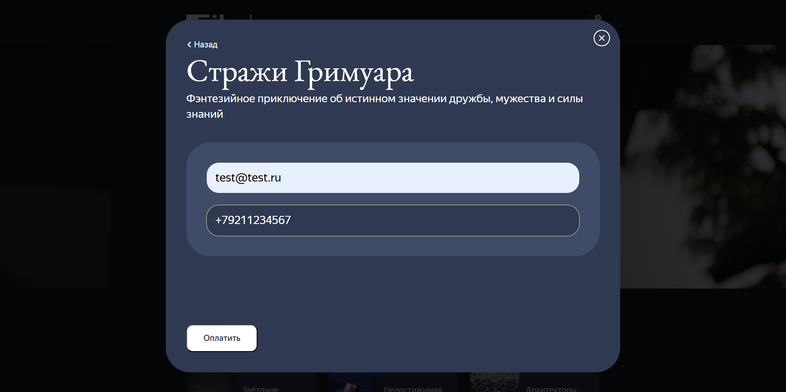
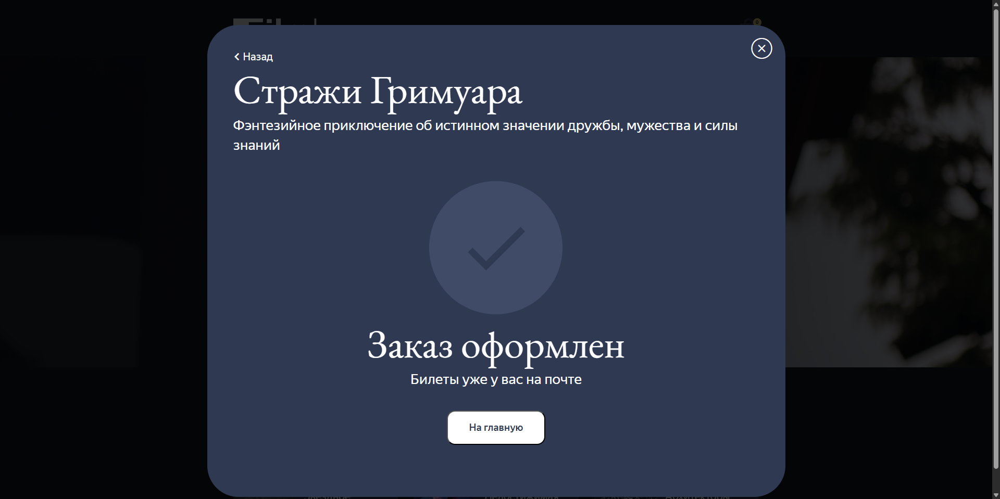

# 🎥 Проект: Сервис покупки билетов в кинотеатре

## 🚀 Технологический стек проекта

Проект построен с использованием современного набора инструментов и библиотек, разделенных на два основных направления:

### 🎯 Фронтенд-стек:
- **React**: быстрая разработка интерактивных компонентов интерфейса.
- **TypeScript**: обеспечивает строгую проверку типов и улучшает качество кода.
- **Vite**: ускоряет сборку и запуск приложений, повышает эффективность разработки.

### 🛠️ Бэкенд-стек:
- **Nest.js**: мощная структура для быстрого написания надежных API-сервисов.
- **MongoDB / PostgreSQL**: гибкость выбора между NoSQL и реляционной базой данных.
- **Docker**: автоматизирует процесс упаковки и доставки приложений в контейнерах.

## 🧑‍💻 Выполненные задачи

В рамках проекта были выполнены следующие задачи:

- 🔥 **Разработана инфраструктура API**: спроектировал и реализовал устойчивое и высокопроизводительное API на платформе Nest.js.
- 🕹️ **Реализовано бронирование билетов**: обеспечено динамическое обновление статусов мест и реализация логики резервирования мест.
- 💾 **Настроены переключаемые базы данных**: интеграция и настройка переключения между PostgreSQL и MongoDB в зависимости от требований проекта.
- 📊 **Организована система журналирования**: настроены три режима логирования (разработка/dev, JSON-формат, TSKV).
- 🐳 **Докеризация проекта**: осуществлена полная докеризация приложения и организована процедура деплоя.

## 📸 Демонстрационные скриншоты

Представлены снимки экранов, наглядно демонстрирующие основные этапы взаимодействия пользователей с сервисом:

### 🏢 Главная страница

### 🗓 Выбор даты и времени сеанса

### 🔍 Выбор места с отображением статуса занятости

### ✅ Подтверждение заказа с детальной информацией о местах

### 💳 Оплата заказа с вводом контактных данных

### ✉ Подтверждение успешного оформления заказа
